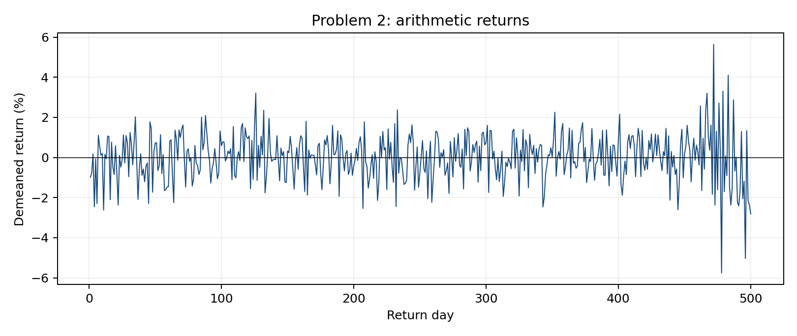
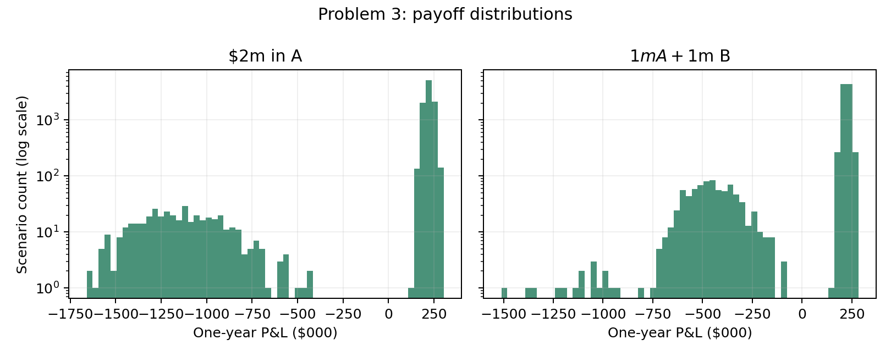
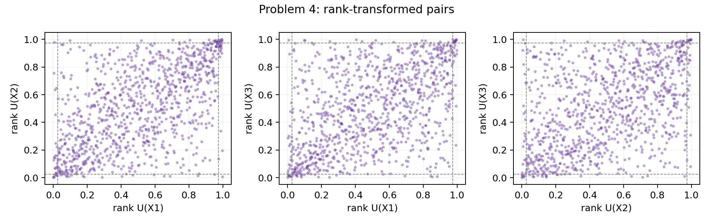

# Assignment 2: Covariance, VaR, and Copulas

FinTech 545 - Quantitative Risk Management

Covariance, Value at Risk, expected shortfall, copulas, and model-based simulation

I worked through each problem in the order requested: make a prediction, fit the model, and then compare the result with the prediction. I saved my predictions in `predictions.md` before running the fitting stage. Throughout the assignment, VaR and ES come from the lower P&L tail and are shown as losses. If VaR is negative, the relevant percentile is still a profit.

## Conventions and course foundation

I used arithmetic returns, `P_t/P_(t-1) - 1`. Historical VaR is the negative lower-tail quantile of P&L, and historical ES is the negative average of the observations at or below that quantile. Sample variances use `n - 1`. I normalized the exponentially weighted weights over the sample and used 100,000 draws with a fixed seed for each simulation.

The main methods come directly from the class notes: Week 3 for PSD matrices, EW volatility, and correlation repairs; Week 4 for VaR; and Week 5 for ES, residual covariance, and copulas.

# 1. Correlations from mismatched histories

## Predict

There are only 81 rows where all five series are present. I expected the complete-case matrix to be PSD because all of its entries use those same rows. The pairwise matrix is different: each correlation can be based on a different set of dates, so the entries may not fit together into one valid matrix. IDX is also very close to a weighted basket of A-D, which should put the smallest eigenvalue near zero. That makes this data set unusually easy to push into non-PSD territory. Before fitting, I thought the correlations involving D, especially C-D, would be the least reliable because they have the fewest common observations.

| Joint n | A | B | C | D | IDX |
| --- | --- | --- | --- | --- | --- |
| A | 242 | 242 | 221 | 93 | 242 |
| B | 242 | 242 | 221 | 93 | 242 |
| C | 221 | 221 | 228 | 83 | 228 |
| D | 93 | 93 | 83 | 96 | 96 |
| IDX | 242 | 242 | 228 | 96 | 250 |

## Fit: correlations, eigenvalues, and Cholesky

| Matrix | A | B | C | D | IDX |
| --- | --- | --- | --- | --- | --- |
| A | 1.0000 | 0.3967 | 0.2466 | 0.4136 | 0.8714 |
| B | 0.3967 | 1.0000 | 0.3169 | 0.2361 | 0.6709 |
| C | 0.2466 | 0.3169 | 1.0000 | 0.1852 | 0.5648 |
| D | 0.4136 | 0.2361 | 0.1852 | 1.0000 | 0.5719 |
| IDX | 0.8714 | 0.6709 | 0.5648 | 0.5719 | 1.0000 |

Complete-case correlation matrix

| Matrix | A | B | C | D | IDX |
| --- | --- | --- | --- | --- | --- |
| A | 1.0000 | 0.4686 | 0.4309 | 0.4384 | 0.8696 |
| B | 0.4686 | 1.0000 | 0.4630 | 0.2767 | 0.7329 |
| C | 0.4309 | 0.4630 | 1.0000 | 0.1846 | 0.7136 |
| D | 0.4384 | 0.2767 | 0.1846 | 1.0000 | 0.6057 |
| IDX | 0.8696 | 0.7329 | 0.7136 | 0.6057 | 1.0000 |

Pairwise correlation matrix

| Estimator | Eigenvalues, ascending | Cholesky |
| --- | --- | --- |
| Complete case | 0.001506, 0.548345, 0.693320, 0.870441, 2.886388 | succeeds |
| Pairwise | -0.011072, 0.471422, 0.528367, 0.857381, 3.153902 | fails |

The complete-case matrix has a smallest eigenvalue of 0.001506. That is small, as expected from the near-linear IDX relationship, but it is still positive. The pairwise estimate pushes the value down to -0.011072, and Cholesky fails on that matrix.

# 1. Repair and reconciliation

## Pairwise covariance and tracking portfolio

I converted the pairwise correlation matrix into a covariance matrix using `Sigma = D C_pair D`, with full-history standard deviations in `D`. The tracking position has weights `(-0.40, -0.30, -0.20, -0.10, 1)`, so its variance is `w' Sigma w`.

| A SD | B SD | C SD | D SD | IDX SD |
| --- | --- | --- | --- | --- |
| 0.016502 | 0.011919 | 0.018324 | 0.022829 | 0.012281 |

The result is **-0.000001799**, which cannot be a real variance. This gives a concrete failure of the PSD condition: a PSD matrix must satisfy `x'Ax >= 0` for every vector `x`, but the tracking-portfolio weights produce a negative value here.

## PSD repairs

| Matrix | Minimum eigenvalue | Frobenius distance | Tracking variance |
| --- | --- | --- | --- |
| Raw pairwise | -0.011071847 | 0 | -0.000001799 |
| Rebonato-Jackel | 1.469e-16 | 0.016182 | 0.000000681 |
| Higham | -1.742e-12 | 0.015520 | 0.000000679 |

After either repair, the minimum eigenvalue is zero within numerical precision and the tracking variance is positive. Higham ends up slightly closer to the original matrix in Frobenius norm. That makes sense because it is solving the nearest-correlation problem iteratively, while Rebonato-Jackel clips the eigenvalues and rescales the diagonal.

## What moved and why

| Entry | Before | After Higham | Absolute change |
| --- | --- | --- | --- |
| A-IDX | 0.869584 | 0.862540 | 0.007045 |
| C-IDX | 0.713575 | 0.708810 | 0.004765 |
| B-IDX | 0.732867 | 0.728687 | 0.004180 |
| D-IDX | 0.605691 | 0.601964 | 0.003727 |
| A-C | 0.430888 | 0.433165 | 0.002277 |

My prediction about the least reliable entries did not match the entries Higham moved most. A-IDX changed the most, followed by C-IDX and B-IDX. The reason is that Higham never sees the pair counts. It only sees the matrix and tries to restore PSD while making the smallest overall Frobenius change. Since IDX is almost a basket of the other assets, its correlations matter a lot for the bad eigenvalue even when they are based on many observations.

The Higham repair has size 0.015520, while the gap between the complete-case and pairwise matrices is 0.423935, about 27 times larger. In this example, choosing the estimator matters much more than choosing the repair. The repair makes the matrix usable, but it does not undo the effect of using different histories.

# 2. Volatility after a regime change

## Predict



Before fitting, my low-to-high ranking was historical, fitted t, equal-weight Normal, EW Normal with lambda 0.97, and EW Normal with lambda 0.94. I was not very confident about the first three because they looked close. I was much more confident that the two EW estimates would be highest, with 0.94 on top, because it puts more weight on the recent high-volatility days.

| lambda | Effective n | Half-life (days) | Weight on last 50 days |
| --- | --- | --- | --- |
| 0.94 | 32.33 | 11.20 | 95.47% |
| 0.97 | 65.67 | 22.76 | 78.19% |

The demeaned sample has variance 0.00014190, skewness -0.1561, and excess kurtosis 2.1659. The skewness is not especially large, but the kurtosis is. Looking at the plot, I would explain that with a calm period followed by a volatile period rather than one stationary Normal distribution.

## Fit

| Method | Volatility / parameters | 5% VaR |
| --- | --- | --- |
| Normal, equal weight | sigma=0.011912 | $19,594 |
| Normal EW, 0.97 | sigma=0.021047 | $34,619 |
| Normal EW, 0.94 | sigma=0.023532 | $38,707 |
| Student t MLE | nu=8.270, loc=0.000182, scale=0.010290 | $18,872 |
| Historical | full sample | $20,514 |

# 2. Reconciliation and use of lambda

The actual low-to-high order is t, equal-weight Normal, historical, EW 0.97, and EW 0.94. I got the two EW estimates right, but I put historical VaR too low. The empirical 5% tail had more medium-sized losses than I expected from the overall shape of the sample. This was a useful reminder that kurtosis alone does not tell me exactly where a particular sample quantile will land.

| Regime | Days | Sample SD |
| --- | --- | --- |
| Earlier calm regime | 450 | 0.010220 |
| Recent volatile regime | 50 | 0.022056 |

The recent SD is about 2.16 times the earlier one. If I mix two Normal regimes with these sample weights and standard deviations, the implied excess kurtosis is 1.936, which is fairly close to the observed 2.166. I therefore read the fitted t with `nu = 8.27` as a convenient description of the full mixed sample. It does not mean either regime is necessarily t distributed on its own.

## Is the EW gap signal or estimation noise?

The two EW VaRs are $4,088 apart. The approximate VaR standard errors are $4,813 for lambda 0.94 and $3,021 for 0.97, so the gap is only 0.72 combined standard errors. I would not treat that difference as clearly larger than estimation noise, even though its direction fits the plot.

**My opinion:** I would use lambda 0.94 for a trading limit because I would want it to react quickly when market conditions change. I would lean toward 0.97 for a capital number because it is more stable and less sensitive to a handful of days. I would still pair the slower capital estimate with a stress floor so that it cannot ignore a lasting regime change.

# 3. When diversification raises VaR

## Predict



| Series | Mean | Variance | Skewness | Excess kurtosis | Return < -20% |
| --- | --- | --- | --- | --- | --- |
| A | 0.0837 | 0.01849 | -4.823 | 22.094 | 406 |
| B | 0.0850 | 0.01745 | -4.916 | 23.087 | 393 |

At least one bond loses more than 20% in 782 scenarios, or 7.82% of the sample. Only 17 scenarios have large losses in both bonds. Since each bond's own default rate is below 5%, I expected the concentrated position's 5% quantile to stay in the non-default outcomes. The diversified position is different because its chance of at least one default is above 5%. My prediction was therefore higher VaR but lower ES for the diversified choice. The very negative skewness and large kurtosis also made me skeptical of a Normal VaR.

## Fit: 5% historical and Normal risk

| Position | Historical VaR | Historical ES | Normal VaR |
| --- | --- | --- | --- |
| $1m A | -$84,570 | $443,628 | $139,971 |
| $1m B | -$86,063 | $419,587 | $132,277 |
| $2m A | -$169,140 | $887,257 | $279,941 |
| $1m A + $1m B | $414,604 | $541,997 | $143,466 |

The negative 5% VaRs for the single bonds and for $2 million in A mean that their fifth-percentile outcomes are still profitable. This is not an error in the sign convention. It is the main reason VaR jumps so sharply once default probability moves above 5%.

# 3. Subadditivity and the 1% result

## Five-percent subadditivity

Historical VaR is not subadditive here. `VaR(A) + VaR(B) - VaR(A+B)` equals -$585,237, so the combined position's VaR is $585,237 larger than the sum of the two separate VaRs. Each bond's own 5% quantile is in the profitable, non-default cluster. Once I combine them, the 7.82% chance of at least one default moves the 5% quantile into a loss cluster.

ES behaves as expected: `ES(A) + ES(B) - ES(A+B)` is $321,218, which is positive. Unlike VaR, ES averages the whole worst 5%. It therefore picks up the fact that splitting the investment reduces how severe the worst losses are.

Normal VaR favors diversification: $143,466 for the split position versus $279,941 for concentrated A. That is the sensible answer if the question is about smooth, continuous risk, but it misses what happens to historical VaR at the 5% cutoff. The Normal model smooths over the separate default state, so it cannot reproduce the probability mass crossing that threshold.

## One-percent historical risk

| Position | Historical 1% VaR | Historical 1% ES |
| --- | --- | --- |
| $1m A | $649,701 | $709,548 |
| $1m B | $640,393 | $700,805 |
| $2m A | $1,299,403 | $1,419,096 |
| $1m A + $1m B | $598,123 | $716,408 |

At 1%, the result flips. Concentrated A has VaR of $1,299,403, compared with $598,123 for the diversified position. At this cutoff, both quantiles are already inside the default-loss region, so the size of the loss matters more than whether default probability crosses the cutoff. The failure at 5% is therefore tied to where the chosen quantile falls relative to the separate payoff states.

# 4. Gaussian or t copula

## Predict: margins and rank tails

| Series | Mean | Variance | Skewness | Excess kurtosis | Kurtosis without most extreme row |
| --- | --- | --- | --- | --- | --- |
| X1 | 0.000257 | 0.0001415 | -0.034 | -0.117 | -0.188 |
| X2 | -0.000252 | 0.0002614 | -0.615 | 7.125 | 1.725 |
| X3 | 0.000890 | 0.0001004 | 0.074 | 2.874 | 1.731 |

My margin choices before fitting were Normal for X1 and t for X2 and X3. Row 952 has a large effect on X2: once I remove it, skewness changes from -0.615 to 0.056 and excess kurtosis falls from 7.125 to 1.725. The remaining X2 data are still heavier-tailed than Normal, but the check shows that one joint extreme is doing a lot of work.



| Pair | Observed lower joint days | Observed upper joint days | Expected under independence |
| --- | --- | --- | --- |
| X1-X2 | 6 | 8 | 0.625 |
| X1-X3 | 7 | 12 | 0.625 |
| X2-X3 | 6 | 9 | 0.625 |

All six corner counts are much larger than the 0.625 expected under independence. The rank plots are positively related throughout, but the bunching near the corners stands out. That led me to predict a t copula, since it can represent common volatility shocks and tail dependence.

## Fit: margins

| Margin | Normal AICc | t AICc | t df | Selected |
| --- | --- | --- | --- | --- |
| X1 | -6022.54 | -6020.19 | 200.00 | normal |
| X2 | -5408.49 | -5518.18 | 5.27 | t |
| X3 | -6365.69 | -6428.02 | 6.09 | t |

The AICc results match my margin predictions. X1 stays Normal, while X2 and X3 select t distributions with degrees of freedom 5.27 and 6.09. I used the CDF from each selected margin to transform the returns into uniforms for the copula step.

# 4. Copula fit and simulated risk

## Kendall correlation and copula likelihood

| R | X1 | X2 | X3 |
| --- | --- | --- | --- |
| X1 | 1.0000 | 0.5833 | 0.5029 |
| X2 | 0.5833 | 1.0000 | 0.4644 |
| X3 | 0.5029 | 0.4644 | 1.0000 |

I converted Kendall's tau to linear correlation with `rho_ij = sin(pi tau_ij / 2)`. The resulting matrix has a minimum eigenvalue of 0.4128, so it is already safely PSD and does not need repair.

| Copula | df | Log likelihood | AICc | BIC |
| --- | --- | --- | --- | --- |
| Gaussian | - | 350.440 | -700.881 | -700.881 |
| t | 3.660 | 451.999 | -901.995 | -897.091 |

The t copula improves log likelihood by 101.559. It also beats the Gaussian by 201.114 AICc points and 196.211 BIC points. The fitted result is therefore consistent with what I saw in the rank plots.

## Portfolio risk for $1m in each asset

| Method | 5% VaR | 5% ES | 1% VaR | 1% ES |
| --- | --- | --- | --- | --- |
| Historical | $47,541 | $65,699 | $67,264 | $102,424 |
| Gaussian copula | $49,897 | $66,886 | $76,750 | $94,593 |
| t copula | $48,997 | $68,041 | $79,185 | $100,218 |

Changing from the Gaussian to the t copula moves 5% VaR by only $900. The changes in 5% ES, 1% VaR, and 1% ES are $1,155, $2,434, and $5,625. The biggest effect is on 1% ES, which averages the most severe joint losses. That is where t-copula tail dependence should matter most. Five-percent VaR is only one quantile in a less extreme part of the distribution, and the two models share the same Kendall-based correlation, so there is much less movement there.

# 4. Joint tails and what likelihood rewards

## Implied joint tail days per 1,000

| Pair | Observed lower / upper | Gaussian lower / upper | t lower / upper |
| --- | --- | --- | --- |
| X1-X2 | 6 / 8 | 6.16 / 6.02 | 9.19 / 9.27 |
| X1-X3 | 7 / 12 | 4.72 / 4.59 | 8.28 / 7.64 |
| X2-X3 | 6 / 9 | 4.34 / 4.21 | 7.50 / 7.53 |

The t copula generally produces more joint corner observations and is closer to the overall amount of tail clustering in the data. It still does not match every pair. For example, X1-X3 has 12 observed upper-tail days, compared with about 7.64 from the t simulation. Since both fitted copulas are symmetric, neither one can fully reproduce the upper/lower differences in this sample.

## Daily log-likelihood contributions

The average daily contribution `ell_t - ell_G` is 0.1016. On 793 days, all three fitted uniforms are between 5% and 95%. Those relatively ordinary days contribute 50.478 log-likelihood units, or 49.7% of the t copula's total advantage. In other words, AICc and BIC are not judging only the dramatic tail days. The t copula also gains by fitting the center and the shoulders of the joint distribution better.

## Tail dependence

X1-X2 is the most correlated pair, with `rho = 0.5833`. Its fitted t-copula tail-dependence coefficient is **0.3219**. For a Gaussian copula with correlation below one, the coefficient is **0**. The Gaussian model can still produce several joint observations at a fixed 2.5% cutoff, but the dependence disappears as the cutoff moves farther into the tail.

# 5. Model-based simulation and residual correlation

## Predict

If the two stocks share a positive industry effect, their residual covariance should be positive. Setting it to zero drops the `+2 Cov(e_A,e_B)` term from P1 variance, so I expected P1 VaR to be understated. For P2, the term enters with a minus sign, so I expected the shortcut to overstate VaR.

## Fit: market regressions

| Stock | alpha | beta | Residual SD |
| --- | --- | --- | --- |
| A | 0.000205 | 1.0353 | 0.012888 |
| B | 0.000315 | 0.9354 | 0.011538 |

The residual correlation is **0.6983**, which is a strong positive relationship left over after controlling for the market. The market SD is 0.010553. I report the fitted intercepts in the table, but I do not add them to simulated returns because the question asks us to assume zero expected returns.

## 100,000-day simulation and delta-Normal VaR

| Portfolio | Full residual covariance | Residual correlation = 0 | Delta-Normal |
| --- | --- | --- | --- |
| P1: long A, long B | $50,345 | $44,501 | $50,415 |
| P2: long A, short B | $15,922 | $28,508 | $15,834 |

The independence shortcut lowers P1 VaR by $5,844 and raises P2 VaR by $12,586, so both directions match my prediction. P2 is more sensitive to the assumption. Its long and short market exposures mostly cancel, which makes the relationship between the two stock-specific residuals much more important. Removing their positive covariance removes a large part of that hedge.

The full-covariance simulation is only $70 away from delta-Normal for P1 and $88 away for P2. Those gaps are small enough to attribute to Monte Carlo noise. In sample, OLS residuals are orthogonal to the market, so `beta beta' Var(MKT) + Sigma_epsilon` rebuilds the stock covariance almost exactly; the largest elementwise difference is only 2.17e-19. With Normal factors, Normal residuals, and linear positions, the factor simulation and delta-Normal calculation describe the same distribution. They would stop agreeing if the factors or residuals were non-Normal, the positions were nonlinear, volatility changed over time, or a constant covariance matrix missed important dependence.

# 6. Reproducibility and references

## Files and commands

The folder includes the analysis code, the report builder, my pre-fit predictions, the five CSV files, figures, and full-precision JSON results. I kept the preliminary and fitting stages separate so it is possible to see that the predictions came first. General calculations are in the installable `qrm545` package, so the risk measures, matrix repairs, distribution fitting, and copula tools can be imported in another project instead of being tied to these five CSV files.

```bash
python3 -m pip install -r requirements.txt
python3 -m pip install -e .
MPLCONFIGDIR=.mplconfig python3 analysis.py prepare
# Inspect the figures and predictions.md before fitting.
MPLCONFIGDIR=.mplconfig python3 analysis.py fit
python3 build_report.py
python3 -m unittest discover -s tests -v
```

The `prepare` and `fit` commands only replace generated figures and JSON result files. Both 100,000-draw simulations use fixed seeds, so rerunning them gives the same numbers. The README has the rest of the setup details and calculation choices.

## Implementation checks

As checks, I confirmed that the complete-case correlation matrix is PSD and that the raw pairwise matrix produces the reported negative portfolio variance. Both repairs have minimum eigenvalues equal to zero within numerical precision, and the t optimizations converged. I also checked that the Kendall-based copula matrix is PSD, that the simulated uniforms never hit exactly zero or one, and that the OLS factor decomposition rebuilds the direct stock covariance to machine precision.

## Course materials used

Dominic Pazzula, *Week 03 - Monte Carlo and Covariance Estimation*, PDF and HTML slides. I used the sections on covariance construction, PSD checks, effective sample size, half-life, volatility standard error, and the two correlation repairs.

Dominic Pazzula, *Week 04 - Returns and Value at Risk*, PDF and HTML slides. I used the material on arithmetic P&L returns, empirical and Normal VaR, the loss sign convention, and VaR subadditivity.

Dominic Pazzula, *Week 05 - Expected Shortfall and Copulas*, PDF and HTML slides. I used the sections on ES, residual covariance, fitted-margin transformations, Kendall's tau, copula likelihoods, simulation, information criteria, and tail dependence.

*Assignment 2 - Covariance, VaR, and Copulas*, assignment PDF/QMD and `problem1.csv` through `problem5.csv`.
