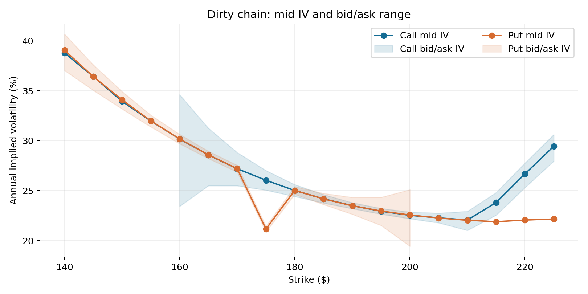
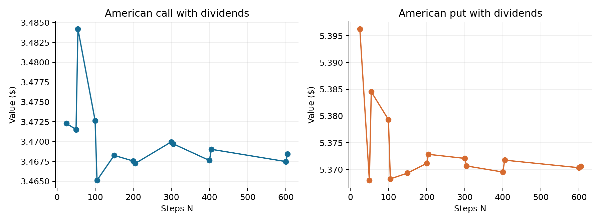
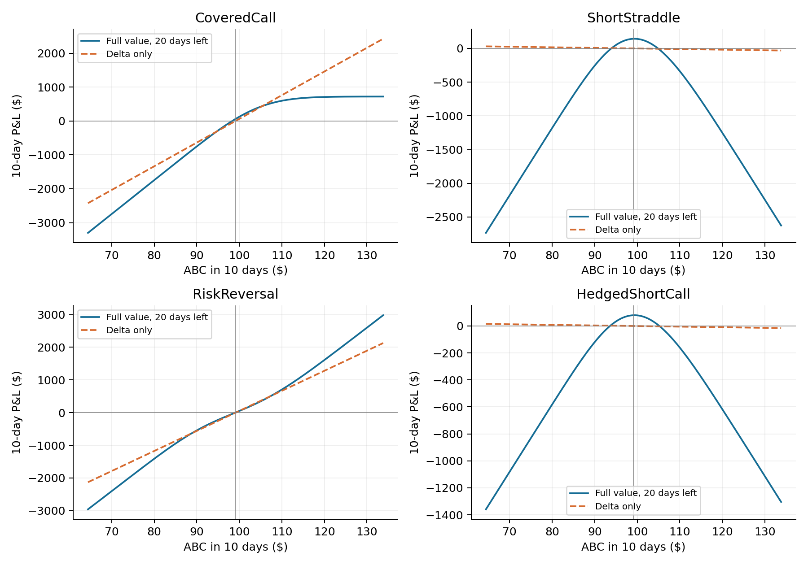
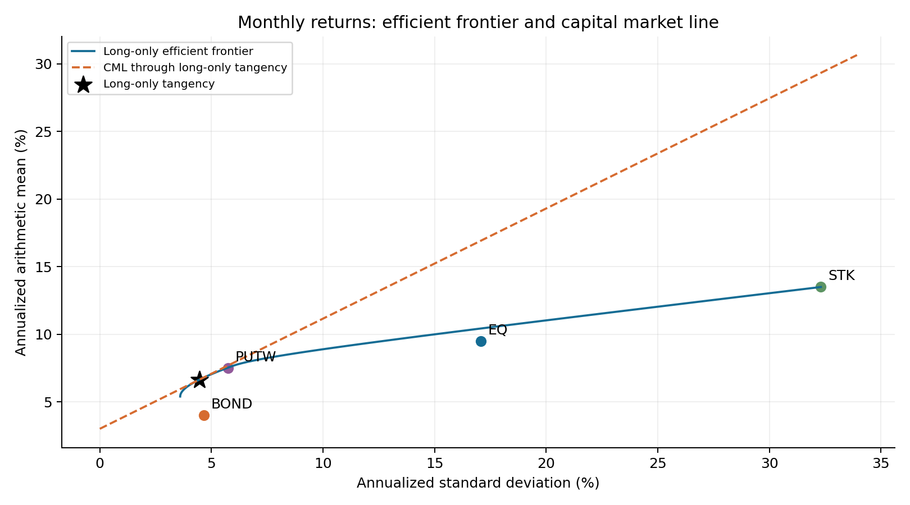
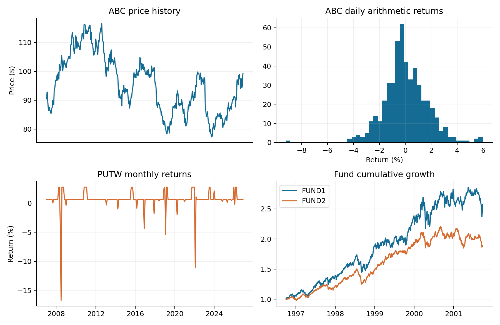

# Assignment 3

FinTech 545 - Quantitative Risk Management

Options, Option Risk, and Portfolio Construction

Prepared 14 November 2026. All prices and factor histories are the supplied assignment data; no live market inputs are substituted.

## Method and reporting conventions

The responses follow Predict, Fit, Reconcile, with each letter of the assignment identified. Predictions were saved in predictions.md after the permitted diagnostics and before the subsequent fits. The preparation timestamp, input hashes and prediction hash are saved with the results.

Returns are arithmetic. Sample variance and covariance use n - 1; skewness and excess kurtosis use finite-sample corrections. Maximum-likelihood Normal variance uses n. AICc = -2ℓ + 2k + 2k(k+1)/(n-k-1). Regression k includes every coefficient, the intercept and residual variance. Conventional OLS standard errors are primary; HC3 diagnostics are also saved.

VaR_α = -q_α(P&L), and ES is the negative average of the worst α probability mass. A negative risk number denotes a gain. Historical VaR uses the inverse empirical CDF; for a fractional tail count, ES weights the boundary observation fractionally. Problem 4 also reports the classroom tail-observation convention so the finite-sample difference is explicit.

Problem 1 uses 35/365 years and continuous yield q = 0.006. Problem 3 uses 255 trading days per year, a 10-day holding period, unchanged IVs and no cash financing leg. Theta is signed dV/dt per model year. Problem 4 uses monthly r_f = 0.03/12; means annualize by 12 and volatility by √12. Problem 5 annualizes daily arithmetic means by 255, with compounded comparisons labeled separately.

## Course foundation reviewed

| Week | Concepts applied or checked |
| --- | --- |
| 1 | Moments, mean standard errors, Normal versus Student t and scale versus standard deviation. |
| 2 | OLS, coefficient uncertainty, residual diagnostics, MLE and AICc parameter counts. |
| 3 | Monte Carlo precision, covariance estimation and preservation of dependence when resampling. |
| 4 | Arithmetic compounding, delta-normal risk and full revaluation over multiple days. |
| 5 | Positive-loss ES, coherence and the different sensitivity of VaR and ES to heavy tails. |
| 6 | Generalized BSM, put-call parity, IV inversion and CRR risk-neutral probabilities. |
| 7 | American exercise, discrete-dividend recursion, Greeks, tangency portfolios and factor models. |
| 8 | Uncertainty in optimized weights and expected returns constructed from factor exposures. |

Sources: Dominic Pazzula, Week01/week01.qmd through Week08/week08.qmd, plus all seven available slide sources in Week02/slides through Week08/slides. Week 1 has lecture notes/PDF but no separate slide deck in this checkout. Relevant implementation references were library/gbsm.jl and Week07/Project/bt_american.jl. The supplied Assignment 3 PDF defines the questions. A source manifest and Chinese study guide accompany the code.

# 1. Implied Volatility from a Dirty Chain

## Predict - (a) parity at every strike

With continuous dividends, C - P = S exp(-qT) - K exp(-rT). I define the signed gap g = C_mid - P_mid - [S exp(-qT) - K exp(-rT)], and use the question's conservative band B = (C_ask - C_bid) + (P_ask - P_bid). A strike is flagged only if |g| > B.

| Strike | Parity gap ($) | Band ($) | Flag |
| --- | --- | --- | --- |
| 140 | -0.004475 | 1.400 | No |
| 145 | 0.000190 | 1.250 | No |
| 150 | -0.005145 | 1.100 | No |
| 155 | -0.000480 | 0.950 | No |
| 160 | -0.000816 | 0.830 | No |
| 165 | -0.001151 | 0.690 | No |
| 170 | -0.001486 | 0.590 | No |
| 175 | 0.888179 | 0.470 | YES |
| 180 | -0.002157 | 0.430 | No |
| 185 | 0.002508 | 0.440 | No |
| 190 | 0.002173 | 0.460 | No |
| 195 | -0.003162 | 0.530 | No |
| 200 | -0.003498 | 0.650 | No |
| 205 | 0.001167 | 0.780 | No |
| 210 | 0.000832 | 0.920 | No |
| 215 | 0.035497 | 1.050 | No |
| 220 | 0.060161 | 1.200 | No |
| 225 | 0.069826 | 1.360 | No |

Only K = 175 is flagged: +$0.888179 against $0.470. The quoted call is expensive relative to the put and the dividend-adjusted stock/strike legs. At least one quote or its metadata is inconsistent; parity alone does not say which leg is wrong. Under frictionless stock and funding assumptions the executable option spread also leaves a positive discrepancy, because even the full-spread band is breached.

## Predict - (b) equality of implied volatilities

For any common σ, GBSM has C(σ) - P(σ) equal to the parity term, which is independent of σ. If the observed mids satisfy parity exactly and σ_C prices the call, then P(σ_C) = C_mid - parity term = P_mid. Positive vega makes the inverse unique, so σ_P = σ_C. A gap inside the spread band is only approximate consistency; it does not force numerically identical mid IVs.

## Predict - (c) inversion reliability

The inverse sensitivity is dσ/dV = 1/vega. Both far ITM and far OTM quotes have low vega, so rounding and spread errors become large IV errors. Calls at K = 215, 220 and 225 all quote $0.05/$0.10, hence a constant $0.075 mid. I predicted a false upward IV wing from that price floor. Deep ITM bids can fall below discounted intrinsic value and fail inversion altogether.

# 1. Fit - (d)-(e) call implied volatilities and vega

I implement GBSM with b = r - q and solve V(σ) - quote = 0 using a bracketed root search. Each bid, mid and ask is checked against its no-arbitrage bounds before inversion. All IV columns below are annual percentages. Vega is dollars per 1.0 change in σ; the last column is the local IV change in percentage points for a $0.01 price increase.

| K | Bid IV (%) | Mid IV (%) | Ask IV (%) | Vega | pp / $0.01 |
| --- | --- | --- | --- | --- | --- |
| 140 | N/A | 38.799 | 56.470 | 1.6318 | 0.6128 |
| 145 | N/A | 36.433 | 49.974 | 2.3732 | 0.4214 |
| 150 | N/A | 33.951 | 43.947 | 3.3902 | 0.2950 |
| 155 | N/A | 31.983 | 38.799 | 5.0566 | 0.1978 |
| 160 | 23.441 | 30.173 | 34.621 | 7.4599 | 0.1340 |
| 165 | 25.502 | 28.582 | 31.258 | 10.7449 | 0.0931 |
| 170 | 25.502 | 27.205 | 28.829 | 14.7579 | 0.0678 |
| 175 | 25.058 | 26.046 | 27.022 | 18.8417 | 0.0531 |
| 180 | 24.424 | 25.021 | 25.617 | 21.8006 | 0.0459 |
| 185 | 23.768 | 24.192 | 24.616 | 22.3970 | 0.0446 |
| 190 | 23.205 | 23.504 | 23.802 | 20.1044 | 0.0497 |
| 195 | 22.657 | 22.947 | 23.233 | 15.6218 | 0.0640 |
| 200 | 22.198 | 22.536 | 22.865 | 10.5050 | 0.0952 |
| 205 | 21.786 | 22.286 | 22.757 | 6.1876 | 0.1616 |
| 210 | 21.031 | 22.067 | 22.937 | 3.1927 | 0.3132 |
| 215 | 22.562 | 23.823 | 24.827 | 2.2580 | 0.4429 |
| 220 | 25.314 | 26.689 | 27.781 | 2.0733 | 0.4823 |
| 225 | 27.965 | 29.447 | 30.623 | 1.9250 | 0.5195 |

The K = 140, 145, 150 and 155 call bids are below L_C = max(0, S exp(-qT) - K exp(-rT)), so no nonnegative volatility can reproduce them. Their mids and asks still invert. This is a bound violation by the bid, not a numerical root-finder failure.

The one-cent approximation is Δσ ≈ 0.01/vega in decimal volatility, or Δσ_pp ≈ 1/vega. It is local: when vega changes sharply across a spread, the full bid-to-ask IV range is more informative. A complete machine-readable table with quote prices and inversion diagnostics is saved in results/p1_quotes.csv.

# 1. Fit - (d)-(e) put implied volatilities and vega

I implement GBSM with b = r - q and solve V(σ) - quote = 0 using a bracketed root search. Each bid, mid and ask is checked against its no-arbitrage bounds before inversion. All IV columns below are annual percentages. Vega is dollars per 1.0 change in σ; the last column is the local IV change in percentage points for a $0.01 price increase.

| K | Bid IV (%) | Mid IV (%) | Ask IV (%) | Vega | pp / $0.01 |
| --- | --- | --- | --- | --- | --- |
| 140 | 37.044 | 39.069 | 40.679 | 1.6886 | 0.5922 |
| 145 | 35.051 | 36.425 | 37.607 | 2.3710 | 0.4218 |
| 150 | 33.187 | 34.102 | 34.936 | 3.4441 | 0.2904 |
| 155 | 31.383 | 31.993 | 32.571 | 5.0609 | 0.1976 |
| 160 | 29.708 | 30.184 | 30.646 | 7.4655 | 0.1339 |
| 165 | 28.217 | 28.593 | 28.962 | 10.7504 | 0.0930 |
| 170 | 26.875 | 27.215 | 27.552 | 14.7621 | 0.0677 |
| 175 | 20.874 | 21.162 | 21.448 | 17.4008 | 0.0575 |
| 180 | 24.641 | 25.031 | 25.420 | 21.8009 | 0.0459 |
| 185 | 23.623 | 24.181 | 24.739 | 22.3968 | 0.0446 |
| 190 | 22.644 | 23.493 | 24.335 | 20.1020 | 0.0497 |
| 195 | 21.522 | 22.967 | 24.343 | 15.6327 | 0.0640 |
| 200 | 19.445 | 22.569 | 25.106 | 10.5300 | 0.0950 |
| 205 | N/A | 22.267 | 26.862 | 6.1734 | 0.1620 |
| 210 | N/A | 22.041 | 29.777 | 3.1774 | 0.3147 |
| 215 | N/A | 21.901 | 33.586 | 1.4603 | 0.6848 |
| 220 | N/A | 22.062 | 37.925 | 0.6582 | 1.5193 |
| 225 | N/A | 22.168 | 42.435 | 0.2716 | 3.6815 |

The K = 205, 210, 215, 220 and 225 put bids violate L_P = max(0, K exp(-rT) - S exp(-qT)). Every mid and every ask in the chain has an IV; exactly nine bids do not. The deep ITM K = 225 put has vega only 0.2716 and a one-cent local IV change of 3.6815 points, illustrating how unstable inversion can be despite a large option price.

N/A means a quote below the discounted intrinsic lower bound. It is not a missing quote or a volatility estimate of zero. The IV band in the chart is therefore unfilled wherever a bid has no admissible inverse.

# 1. Reconcile - the two data problems

## (f) The parity outlier in volatility units

At K = 175, call mid IV is 26.0457% and put mid IV is 21.1620%, a 4.8837-point difference. Linearizing at the call's vega 18.8417 gives g/vega = 4.7139 vol points; using the put's vega 17.4008 gives 5.1042. The actual gap lies between these estimates, as vega changes over this finite IV interval. The chart shows a downward put outlier, although the parity test itself identifies only relative inconsistency.

## (g) The call wing above 210

Call mid IV rises from 22.067% at 210 to 23.823%, 26.689% and 29.447% at 215, 220 and 225. The corresponding one-cent sensitivities are 0.443, 0.482 and 0.519 vol points, and the bid/ask IV ranges are 22.562-24.827%, 25.314-27.781% and 27.965-30.623%. Inverting the same small quote at increasingly remote strikes mechanically requires more volatility. The upturn is mainly evidence about quote floors and resolution, not reliable evidence of market pricing of upside tail risk. Wide IV ranges alone do not establish the cause; the identical bids, asks and mids provide the additional diagnosis.

Parity did not flag those strikes because the dollar discrepancy is small relative to the deep ITM put's wide dollar spread. A large discrepancy measured in IV points need not be large in dollars when vega is low. Parity is a cross-contract price-consistency check; it is not a test of quote informativeness.

## (h) The usable shape

Excluding K = 175's inconsistent pair and the floor-dominated call wing, IV declines from roughly 39% at low strikes to about 22% at high strikes. The broad shape is a downside skew or smirk, rather than a symmetric smile. Downside puts command higher implied volatility, consistent with demand for downside protection and a priced left tail. This is an interpretation of option prices, not a claim that an IV curve alone identifies physical crash probabilities.

# 2. American Options and Discrete Dividends

## Predict - (a) exercise condition

| Dividend time | Cash D | K[1 - exp(-r(T-t))] | Conclusion |
| --- | --- | --- | --- |
| 0.10 | $0.25 | $0.891948 | Fails: no call exercise incentive |
| 0.40 | $1.50 | $0.224495 | Passes: exercise can be optimal if ITM |

The first dividend is below its strike-financing threshold, while the second exceeds it substantially. Passing is a permission for sufficiently high stock prices, not a rule to exercise every call. Remaining optionality still has to be compared with intrinsic value.

## Predict - (b) directions

I predicted both call values would decrease, both put values would increase, the American call premium would increase from zero, and the American put premium would shrink. The call holder can recover some dividend exposure through optimal exercise before the large second dividend. The put holder benefits from waiting for the downward cash jump, reducing the value of exercising early.

## Fit - (c) prices and present-value adjustment

The CRR inputs are Δt = T/N, u = exp(σ√Δt), d = 1/u, p = [exp(rΔt)-d]/(u-d), with discount exp(-rΔt). Every dividend date is exactly on the grid. At each cash jump, independent subtrees begin at S-D and American values are compared with intrinsic at pre-dividend S. Distinct histories never recombine after a dividend. Exercise immediately after a dividend is also allowed by the next subtree's root.

| Option | No dividend | With cash dividends | GBSM PV adjustment |
| --- | --- | --- | --- |
| European call | $3.922268 | $3.174061 | $3.072293 |
| American call | $3.924661 | $3.467612 | Not an American formula |
| European put | $4.309830 | $5.283742 | $5.181974 |
| American put | $4.440089 | $5.369523 | Not an American formula |

The European no-dividend entries use GBSM; American entries and all cash-dividend entries use N = 400. PV(dividends) = $1.722119, giving adjusted spot $46.777881. Subtracting the cash PV before using GBSM understates both European tree prices by about $0.102. It approximates the forward level but does not reproduce multiplicative volatility between deterministic dollar jumps. It also cannot price optimal exercise.

# 2. Fit - (d) convergence

| N | Call, no div. | Put, no div. | Call, cash div. | Put, cash div. |
| --- | --- | --- | --- | --- |
| 25 | 3.919813 | 4.436296 | 3.472275 | 5.396221 |
| 50 | 3.942130 | 4.457476 | 3.471515 | 5.367981 |
| 55 | 3.907738 | 4.431101 | 3.484165 | 5.384513 |
| 100 | 3.928310 | 4.443738 | 3.472648 | 5.379319 |
| 105 | 3.926240 | 4.443497 | 3.465115 | 5.368243 |
| 150 | 3.921029 | 4.437416 | 3.468253 | 5.369322 |
| 200 | 3.917604 | 4.435280 | 3.467544 | 5.371135 |
| 205 | 3.927075 | 4.442437 | 3.467231 | 5.372829 |
| 300 | 3.923772 | 4.439703 | 3.469960 | 5.372075 |
| 305 | 3.923791 | 4.439322 | 3.469705 | 5.370659 |
| 400 | 3.924661 | 4.440089 | 3.467612 | 5.369523 |
| 405 | 3.920715 | 4.436790 | 3.469018 | 5.371744 |
| 600 | 3.923008 | 4.438458 | 3.467478 | 5.370331 |
| 605 | 3.923163 | 4.438741 | 3.468410 | 5.370594 |

For example, N = 100 and 105 give cash-dividend calls of $3.472648 and $3.465115, and puts of $5.379319 and $5.368243. At 600/605 the calls are $3.467478/$3.468410 and puts $5.370331/$5.370594. Convergence is oscillatory, so one subsequence can give false confidence. The reported N = 400 base prices should be read as approximately $3.468 for the American call and $5.370 for the put; six printed decimals identify the computation, not six-decimal continuum accuracy.

# 2. Fit and reconcile - sensitivities and exercise

## Fit - (e) central finite-difference Greeks at N = 400

For each American price V(S), delta = [V(S+h)-V(S-h)]/(2h), and gamma = [V(S+h)+V(S-h)-2V(S)]/h². The grid and dividend dates remain fixed for all bumps.

| Spot bump h | Call delta | Call gamma | Put delta | Put gamma |
| --- | --- | --- | --- | --- |
| 1.000 | 0.502442 | 0.041517 | -0.547175 | 0.039530 |
| 0.100 | 0.489645 | 0.035738 | -0.552354 | 0.092420 |
| 0.010 | 0.487928 | 0.008903 | -0.553103 | 0.095788 |
| 0.001 | 0.487906 | -0.000000 | -0.553115 | 0.053227 |

## Fit - (f) sensitivity to each dividend amount

Entries are dollars of option value per additional dollar of the specified dividend. They are central differences, holding dividend dates fixed. Both cash-amount bumps are reported to expose numerical sensitivity.

| Dividend | Bump | Euro call | Amer. call | Euro put | Amer. put |
| --- | --- | --- | --- | --- | --- |
| D1 at 0.10 | 0.010 | -0.435405 | -0.467916 | 0.560105 | 0.567853 |
| D1 at 0.10 | 0.001 | -0.435365 | -0.467900 | 0.560145 | 0.567871 |
| D2 at 0.40 | 0.010 | -0.380401 | -0.107527 | 0.601760 | 0.609777 |
| D2 at 0.40 | 0.001 | -0.380349 | -0.107509 | 0.601812 | 0.609802 |

## Reconcile - (g) premiums and the exercise boundary

| Premium American - European | No dividends | Cash dividends |
| --- | --- | --- |
| Call, matched tree | $0.000000 | $0.293551 |
| Put, matched tree | $0.127866 | $0.085781 |

The call premium rises from zero to $0.293551, while the put premium falls from $0.127866 to $0.085781, consistent with the predictions. Matched-tree premiums isolate the exercise right from lattice error. Relative to exact GBSM instead, the no-dividend put premium is $0.130259 and the finite-N call difference is $0.002393; that tiny call difference is discretization error, since the true no-dividend call premium is zero.

Immediately before D2, exercise is optimal above pre-dividend stock price S* ≈ $52.71504 on the same remaining CRR lattice. I solve S* - 50 = C_A(S* - 1.50, 50, 0.10). There are no later dividends, so C_A equals the European call in the continuum; replacing the remaining tree by GBSM gives $52.71685, an independent boundary check.

# 2. Reconcile - the finite-difference Greeks

## (h) Why gamma does not settle

Gamma is the unstable Greek. Call gamma drops from about 0.0415 at h = 1 to essentially zero at h = 0.001; put gamma also changes markedly. At fixed N, terminal payoffs, discounted sums and maxima make the price piecewise linear in spot. Inside one linear segment its second derivative is zero; a bump crossing one or more kinks produces a nonzero, sometimes sharply varying quotient. Shrinking h at fixed N therefore does not converge reliably to the smooth model's gamma. This is a lattice-resolution issue in addition to ordinary floating-point cancellation; use joint grid refinement and a bump large enough to span lattice features.

## Reconcile - (i) the two call dividend sensitivities

The American call loses about $0.468 per additional dollar of D1, but only $0.108 per dollar of D2. Before D1 the dividend is too small to justify giving up the option, so the call remains exposed to the cash drop. Before D2, sufficiently ITM holders exercise and avoid that option-value loss. This exercise right limits the second-dividend sensitivity. The European call cannot exercise and has much closer sensitivities, about -0.435 and -0.380; timing and exercise both matter.

# 3. VaR of an Option Book - predictions and fit

## Predict - (a) aggregate Greeks and ranking

ABC closes at $99.12 on 2026-11-13. Options initially have 30/255 years left, and each option represents one share. The quantities below already include all positive and negative holdings. Theta is dollars per model year; gamma is dollars per squared dollar of spot change.

| Book | Current value ($) | Delta | Gamma | Theta / year |
| --- | --- | --- | --- | --- |
| Covered call | 9744.781 | 69.916054 | -3.792522 | 1477.776 |
| Short straddle | -788.439 | -0.888844 | -8.092138 | 3313.355 |
| Risk reversal | -65.793 | 61.388729 | 0.535962 | 18.588 |
| Hedged short call | 4580.843 | -0.444422 | -4.046069 | 1868.118 |

I ranked the expected missed absolute tail risk: ShortStraddle, HedgedShortCall, CoveredCall, then RiskReversal. The first two are almost delta neutral but strongly short gamma, so delta normal should severely understate risk. The covered call is also short gamma, with positive theta offsetting some loss. RiskReversal has small positive local gamma; I predicted modest overstatement at 5%, with less confidence in the far tail where local gamma may change sign.

## Predict - (b) no-move P&amp;L and tail ratios

All four initial thetas are positive, so I predicted positive ten-day P&L at unchanged spot, smallest for RiskReversal. For the nearly hedged short-gamma books, a squared-move loss should give ES/VaR substantially above the zero-mean normal's 1.254 at 5%. At 1% the zero-mean normal benchmark is 1.146, not 1.25; nonzero mean shifts either ratio.

## Fit - (c) moments and distribution choice

| Observations | Mean | Variance | SD | Skew | Excess kurtosis |
| --- | --- | --- | --- | --- | --- |
| 500 | 0.00032140 | 0.00027803 | 1.6674% | 0.01912 | 2.46394 |

| Daily model | Location μ | Scale | Implied SD | ν | AICc |
| --- | --- | --- | --- | --- | --- |
| Normal | 0.00032140 | 0.01665760 | 0.01665760 | N/A | -2671.9260 |
| StudentT | 0.00000117 | 0.01350621 | 0.01669432 | 5.78922 | -2700.3487 |

Student t wins by about 28.42 AICc units. Its scale 0.013506 is not its standard deviation; SD = scale × √[ν/(ν-2)] ≈ 0.016694. The sample is nearly symmetric but fat tailed, agreeing with the prefit prediction. Both distributions are fitted with a free location, then reset to exactly zero population mean for risk simulation, as required. No sample-mean drift is carried into the scenarios.

# 3. Fit - (d)-(e) ten-day risk

Delta-normal uses σ_P = |δ| S_0 s_daily√10, VaR = -z_ασ_P, and ES = φ(z_α)σ_P/α, with zero drift and no theta adjustment. Using dollar sensitivities avoids dividing by a negative or small book value. The daily sample SD is 1.667428%.

| Book | DN VaR 5% | DN ES 5% | DN VaR 1% | DN ES 1% |
| --- | --- | --- | --- | --- |
| Covered call | 601.05 | 753.74 | 850.08 | 973.91 |
| Short straddle | 7.64 | 9.58 | 10.81 | 12.38 |
| Risk reversal | 527.75 | 661.81 | 746.40 | 855.12 |
| Hedged short call | 3.82 | 4.79 | 5.40 | 6.19 |

Full revaluation uses 1,000,000 independent ten-day paths per model, with seeds 5452026 and 5452027. Daily returns are iid draws from the fitted zero-location Normal or t. I compound S_10 = S_0 × ∏(1+r_j), hold IV fixed, reduce expiry from 30 to 20 trading days and reprice each position. I do not multiply a one-day Student t draw by √10; the sum or product of independent t draws is not itself a t with the same degrees of freedom.

## Normal: full revaluation; all dollar P&L

| Book | Mean | VaR 5% | ES 5% | VaR 1% | ES 1% |
| --- | --- | --- | --- | --- | --- |
| Covered call | 6.56 | 677.63 | 870.48 | 990.49 | 1146.33 |
| Short straddle | 19.81 | 314.80 | 483.25 | 589.22 | 748.01 |
| Risk reversal | 8.78 | 489.80 | 638.58 | 730.00 | 862.84 |
| Hedged short call | 18.20 | 149.10 | 233.32 | 286.31 | 365.71 |

## StudentT: full revaluation; all dollar P&L

| Book | Mean | VaR 5% | ES 5% | VaR 1% | ES 1% |
| --- | --- | --- | --- | --- | --- |
| Covered call | 6.31 | 677.71 | 895.43 | 1028.14 | 1224.25 |
| Short straddle | 20.04 | 321.57 | 519.16 | 636.90 | 843.91 |
| Risk reversal | 8.33 | 489.86 | 659.75 | 760.87 | 932.05 |
| Hedged short call | 18.32 | 152.48 | 251.28 | 310.15 | 413.66 |

All simulated daily returns exceeded -100%, so no sampled path needed truncation or rejection. The unbounded arithmetic-return families do assign a small theoretical probability to impossible negative prices; that model limitation is not repaired by changing the requested sampling rule. Means and tail losses are Monte Carlo estimates. Across twenty independent batches, 1% ES standard errors range from roughly $1-$2 under Normal and $1.5-$3 under t. Parameter uncertainty and model error are additional and are not included in those simulation standard errors.

# 3. Fit - (f) full P&amp;L versus delta only

The covered call loses approximately like stock on the downside and gives up upside through the short call. The short straddle and hedged short call can lose on large moves in either direction, despite almost-flat delta lines at today's spot. RiskReversal has appreciable directional exposure; its nonlinear put wing becomes important as the stock falls. The vertical displacement at unchanged spot is time decay, which the delta-only line omits.

## Reconcile - no-move gains versus simulated mean

| Book | Spot fixed: actual P&L | Initial Θ × 10/255 | Normal mean | t mean |
| --- | --- | --- | --- | --- |
| Covered call | 60.55 | 57.95 | 6.56 | 6.31 |
| Short straddle | 143.06 | 129.94 | 19.81 | 20.04 |
| Risk reversal | 3.73 | 0.73 | 8.78 | 8.33 |
| Hedged short call | 79.83 | 73.26 | 18.20 | 18.32 |

The actual no-move gains agree in sign with all four predictions. They differ from Θ × Δt because theta itself changes over the ten-day interval. Positive expected underlying return was not assumed; option time decay can generate positive mean book P&L even when E[S_10-S_0] = 0.

# 3. Reconcile - (g) what gamma repairs and misses

The nearly hedged books have DN 5% VaR of only $7.64 and $3.82. Their Normal full-revaluation values are $314.80 and $149.10. Delta normal sees only δΔS, so it misses the negative ½Γ(ΔS)² term and positive ΘΔt. These books are not protected against large moves merely because their initial delta is small.

I evaluated both δΔS + ½Γ(ΔS)² and δΔS + ½Γ(ΔS)² + Θ(10/255) on exactly the same terminal-price scenarios used for full revaluation. The next table gives the three 5% comparisons; the following table gives the harder 1% ES comparison. All entries are dollars.

| Model / book | Full VaR 5% | ΔΓ VaR 5% | ΔΓΘ VaR 5% | Full ES 5% | ΔΓΘ ES 5% |
| --- | --- | --- | --- | --- | --- |
| N / Covered call | 677.63 | 717.40 | 659.45 | 870.48 | 872.39 |
| N / Short straddle | 314.80 | 422.48 | 292.54 | 483.25 | 491.85 |
| N / Risk reversal | 489.80 | 494.69 | 493.96 | 638.58 | 604.09 |
| N / Hedged short call | 149.10 | 211.24 | 137.98 | 233.32 | 237.63 |
| t / Covered call | 677.71 | 717.48 | 659.53 | 895.43 | 902.52 |
| t / Short straddle | 321.57 | 430.39 | 300.46 | 519.16 | 536.83 |
| t / Risk reversal | 489.86 | 494.73 | 494.00 | 659.75 | 617.77 |
| t / Hedged short call | 152.48 | 215.20 | 141.94 | 251.28 | 260.12 |

| Book | Normal full ES 1% | Normal ΔΓΘ ES 1% | t full ES 1% | t ΔΓΘ ES 1% |
| --- | --- | --- | --- | --- |
| Covered call | 1146.33 | 1189.95 | 1224.25 | 1288.48 |
| Short straddle | 748.01 | 830.97 | 843.91 | 963.87 |
| Risk reversal | 862.84 | 758.18 | 932.05 | 800.00 |
| Hedged short call | 365.71 | 407.19 | 413.66 | 473.64 |

Gamma improves the near-flat delta diagnosis but does not reproduce the full values. Adding gamma without theta overstates losses by discarding the time-decay gain. Even with theta, the local expansion freezes all Greeks, omits higher orders and omits time/spot cross effects. RiskReversal illustrates the limitation sharply: positive gamma at today's spot does not protect the far put wing, so its 1% ES is understated by the local expansion. This is the weakness anticipated in the prediction, and why the 5% overstatement prediction should not be extrapolated to all tail measures.

## Reconcile - (h) compensation for short gamma

The short-gamma books' simulated means are positive but much smaller than their no-move gains. Implied volatilities are around 27-29%, versus approximately 26.63% annualized realized daily volatility, allowing time decay to exceed the expected gamma cost in this model. The positive mean pays for convex losses on large moves, including jumps and unhedged tail moves; it is an insurance premium, not a free return. A larger realized variance or a volatility jump could reverse it.

# 3. Reconcile - (i)-(j) distributional risk and a flat book

| Book | Normal ES/VaR 5% | t ES/VaR 5% | t ΔVaR 5% | t ΔES 1% |
| --- | --- | --- | --- | --- |
| Covered call | 1.285 | 1.321 | 0.08 | 77.92 |
| Short straddle | 1.535 | 1.614 | 6.76 | 95.90 |
| Risk reversal | 1.304 | 1.347 | 0.06 | 69.20 |
| Hedged short call | 1.565 | 1.648 | 3.38 | 47.95 |

The short straddle and hedged short call have the largest ES/VaR ratios, about 1.53/1.56 under Normal and 1.61/1.65 under t. This agrees with the nonlinear-tail prediction even when the underlying return model itself is Normal. Nonlinear pricing changes the shape of the P&L distribution.

Switching to t changes CoveredCall and RiskReversal 5% VaR by less than ten cents in this run, within simulation error. It increases ShortStraddle and HedgedShortCall 5% VaR by about $6.76 and $3.38. The corresponding 1% ES increases are about $77.92, $69.20, $95.90 and $47.95 for CoveredCall, RiskReversal, ShortStraddle and HedgedShortCall, respectively. Relative 1% ES increases are greatest in the two short-gamma books, around 13%; squared-move losses put more weight on extremes. The short straddle has the largest absolute increase.

The fitted models have almost identical daily SDs but different tail shapes. Around the 5% one-sided quantile the central mass and tail reallocation largely offset, and ten-day aggregation further reduces central differences. ES averages beyond that threshold, and 1% risk reaches farther into the region where the t density dominates. Therefore a small 5% VaR change is not evidence that the model choice is immaterial.

Relative to Normal full revaluation, the predicted ranking of missed absolute 5% VaR is confirmed: $307.16 for ShortStraddle, $145.28 for HedgedShortCall, $76.58 for CoveredCall, versus a $37.94 overstatement for RiskReversal. In the t 1% tail, however, RiskReversal's DN VaR and ES understate the full values. The part missed by a simple sign-of-gamma argument is the changing gamma in the remote put wing and the heavier underlying tail.

## (j) Two sentences to the risk manager

The book is approximately delta neutral today (delta -0.444 shares), but it remains short gamma and exposed to theta, volatility changes and large moves in either direction. Its ten-day 5% VaR is about $152 and 1% ES about $414 under the fitted t full-revaluation model, so calling it flat materially understates its risk.

# 4. A Sharpe Ratio That Sells Insurance

## Predict - (a) moments, Sharpe and the influential month

The file has 240 monthly total-return observations. I use monthly rf = 0.25%, annual Sharpe = √12 × (mean - rf)/SD, and excess kurtosis. Means and SDs in the table are monthly; variance is in decimal-return squared units.

| Asset | Mean | Variance | SD | Skew | Excess kurt. | Ann. SR |
| --- | --- | --- | --- | --- | --- | --- |
| EQ | 0.790% | 0.0024272 | 4.927% | -0.387 | 3.519 | 0.3798 |
| BOND | 0.333% | 0.0001812 | 1.346% | 0.087 | 0.517 | 0.2128 |
| STK | 1.124% | 0.0086986 | 9.327% | -0.061 | 0.812 | 0.3248 |
| PUTW | 0.624% | 0.0002739 | 1.655% | -6.567 | 61.142 | 0.7834 |

PUTW stands out: high Sharpe accompanies -6.57 skew and 61.14 excess kurtosis. June 2008 lost 16.7197% and contributes 45.95% of its centered sum of squares. Removing this single month changes its monthly mean from 0.6243% to 0.6969%, SD from 1.6551% to 1.2172%, and annual Sharpe from 0.7834 to 1.2717. Skew and excess kurtosis remain -4.50 and 40.74 after removal. The tail structure is not explained away by one observation, and deleting the bad month would make the strategy look artificially safer.

## Predict - (b) portfolio concentration and normal ES

Before optimization I expected PUTW to take a dominant 50-80% weight, and expected the resulting historical 1% ES to greatly exceed a matched Normal ES. Its many smooth premium months conceal infrequent large insurance payouts. With only 240 observations the 1% tail contains 2.4 months of probability mass, so the empirical estimate is also imprecise.

## Fit - (c) three maximum-Sharpe portfolios

All risky-asset weights sum to one. The unconstrained solution is proportional to Σ^-1(μ-rf·1). For the other two, I minimize a convex quadratic variance after fixing excess return in rescaled holdings, then normalize; the 20% cap becomes a linear inequality. No risk-free asset is included in the four-asset weight table.

| Portfolio | EQ | BOND | STK | PUTW | Ann. SR |
| --- | --- | --- | --- | --- | --- |
| Unconstrained | -4.387% | 24.650% | 2.269% | 77.468% | 0.8198 |
| Long only | 0.000% | 26.068% | 0.919% | 73.013% | 0.8153 |
| PUTW ≤ 20% | 14.625% | 63.621% | 1.754% | 20.000% | 0.5902 |

The long-only optimizer assigns PUTW 73.013%, within the predicted range, and nearly eliminates EQ. The unconstrained portfolio shorts EQ by 4.387% and holds PUTW at 77.468%. Imposing the cap forces PUTW to 20%, increases BOND to 63.621% and lowers estimated Sharpe from 0.8153 to 0.5902. The precise decimals describe fitted weights rather than confidence in their stability.

# 4. Fit - the frontier and tail risk

## (d) Monthly VaR and ES, in percent of portfolio capital

| Portfolio / model | VaR 5% | ES 5% | VaR 1% | ES 1% |
| --- | --- | --- | --- | --- |
| Unconstrained / Historical | 0.374% | 2.898% | 3.811% | 9.248% |
| Unconstrained / Normal | 1.574% | 2.115% | 2.456% | 2.895% |
| Long only / Historical | 0.290% | 2.926% | 3.907% | 9.205% |
| Long only / Normal | 1.564% | 2.102% | 2.441% | 2.877% |
| PUTW ≤ 20% / Historical | 1.559% | 2.837% | 3.081% | 5.491% |
| PUTW ≤ 20% / Normal | 1.670% | 2.214% | 2.557% | 2.998% |

The long-only historical 1% ES is 9.205%, versus 2.877% from the matched Normal, a factor of about 3.20. The cap reduces historical 1% ES to 5.491%, even though matched-Normal ES rises slightly to 2.998%. The cap helps in the observed crash tail, not necessarily at every quantile: its historical 5% VaR rises as the portfolio holds less of PUTW's frequent small gains. This is why reporting only one quantile can reverse the apparent comparison.

Finite-sample ES convention: primary 1% ES averages the two worst months plus 0.4 of the third, divided by 2.4. The classroom shortcut instead averages all three observations at or below the interpolated quantile, giving 1% ES of 8.160%, 8.145% and 5.009% for unconstrained, long-only and capped portfolios. At 5% both conventions use twelve months and agree. The 1% difference is a small-sample convention effect; either calculation retains the insurance-tail conclusion.

# 4. Reconcile - conditional exposure and input uncertainty

## Fit - (e) CAPM and stress beta

| Regression | n | Alpha / month | t(alpha) | Beta | R² |
| --- | --- | --- | --- | --- | --- |
| All months | 240 | 0.2745% | 3.0516 | 0.18479 | 0.30255 |
| EQ excess < -5% | 26 | 5.8652% | 15.1317 | 0.94285 | 0.95209 |

Full-sample alpha is 0.274481% per month (3.2938% arithmetically annualized), with conventional t = 3.0516; beta is 0.184786 and R² is 0.302554. In the 26 months when EQ excess return is below -5%, beta is 0.942847, about 5.10 times the full-sample estimate. The stress regression includes its own intercept; it is a conditional fit, not the same alpha estimated from the full sample. HC3 reduces the full-sample alpha t statistic to 2.1899, showing that standard-error assumptions also matter.

## Reconcile - (f) what the optimizer bought, and ES coherence

It bought a concentrated short-put insurance exposure combined with cash-like premium months and a bond allocation. Sharpe depends only on the first two moments; it is unchanged if losses are rearranged into a much more negatively skewed distribution with the same mean and variance. Fully cash securing the strike avoids borrowing and margin leverage, but it does not remove the nonlinear loss when EQ falls below the strike.

ES directly averages the severity of the worst losses. Monotonicity makes worsening losses in a tail state increase risk; positive homogeneity scales those losses with position size; translation invariance handles certain cash offsets; subadditivity gives a coherent diversification rule. These properties support meaningful aggregation, but do not make a fitted Normal ES correct for a non-Normal strategy. The empirical tail distribution, as well as the measure, must capture the insurance payout.

## Reconcile - (g) interpreting alpha

A positive CAPM alpha is not convincing evidence of skill here. A single constant beta averages across calm months, when the short put has low market sensitivity, and crash months, when its delta approaches one and losses accelerate. The 0.185 versus 0.943 betas expose that state dependence. The intercept can therefore label compensation for selling downside convexity as alpha because the linear market model omitted the option payoff.

## Reconcile - (h) mean standard errors

| Asset | Mean / month | SE(mean) | Approximate 95% interval |
| --- | --- | --- | --- |
| EQ | 0.7901% | 0.3180% | [0.167%, 1.413%] |
| BOND | 0.3327% | 0.0869% | [0.162%, 0.503%] |
| STK | 1.1244% | 0.6020% | [-0.056%, 2.304%] |
| PUTW | 0.6243% | 0.1068% | [0.415%, 0.834%] |

These are iid standard errors s/√240, not robust confidence guarantees for an insurance strategy. Subtracting a fixed rf does not change the SE. EQ, BOND and STK have excess-mean t ratios of only about 1.70, 0.95 and 1.45; PUTW's is 3.50 but its highly skewed tail makes a Gaussian interval a weak description of uncertainty. Twenty years of monthly observations still leave substantial uncertainty in the mean inputs the optimizer amplifies.

# 4. Reconcile - resampling the tangency weights

I resampled 500 sets of 240 whole months, preserving cross-asset dependence within each draw, then re-estimated means, covariance and maximum-Sharpe weights. The table gives marginal 5th-95th percentile weight intervals, not a joint confidence region. The seed is 5452036.

| Portfolio | EQ interval | BOND interval | STK interval | PUTW interval |
| --- | --- | --- | --- | --- |
| Unconstrained | -32.2% to 15.6% | -21.9% to 62.3% | -8.3% to 16.5% | 32.5% to 128.6% |
| Long only | 0.0% to 11.5% | 0.0% to 64.1% | 0.0% to 7.8% | 28.4% to 100.0% |
| PUTW ≤ 20% | 0.0% to 49.3% | 18.9% to 78.4% | 0.0% to 16.6% | 20.0% to 20.0% |

All long-only and capped bootstrap solves succeeded. For unconstrained tangency, 498 of 500 draws had a positive-budget tangency direction; the other two are explicitly excluded, so its interval is conditional on that direction existing. Negative excess-premium realizations can make the finite unconstrained budget-normalized tangency construction inappropriate.

Long-only PUTW ranges from about 28.4% to 100%, and unconstrained PUTW from about 32.5% to 128.6%. This is large weight uncertainty despite the same 240-month sample size. I would trust the qualitative observation that Sharpe optimization favors PUTW and that a cap mechanically limits the exposure. I would not trust the exact 73.013% estimate, the small STK allocation, or the precise unconstrained short-EQ weight as stable investment prescriptions.

The PUTW cap is active at 20% in most resamples; that stability comes from the constraint, not precise estimation. Rare bootstrap samples omit enough loss months to produce extremely different insurance-risk estimates, which is part of the economic concern rather than a numerical failure. The iid month bootstrap also does not capture serial dependence or unseen regimes; it is a sensitivity analysis of the available sample.

# 5. Alpha or Factor Exposure? - predictions

## Predict - (a) excess performance and CAPM

I join the two factor files by date, strip the trailing spaces from the momentum header, divide percentage factors and RF by 100, then join to the funds' decimal returns. All 1257 fund observations match, covering 1 October 1996 through 28 September 2001. Each dependent variable is fund return minus that day's RF; Mkt-RF is already an excess return and is not reduced by RF a second time.

| Fund | Daily mean excess | Daily total SD | Daily excess SD | Annual excess SR | CAPM alpha bp/day | t(alpha) |
| --- | --- | --- | --- | --- | --- | --- |
| FUND1 | 0.06236% | 1.1745% | 1.1746% | 0.8479 | 4.4066 | 3.2043 |
| FUND2 | 0.03376% | 0.7186% | 0.7187% | 0.7500 | 2.4491 | 1.8349 |

FUND1 initially looks more skilled: higher excess Sharpe and a larger CAPM alpha with a t statistic above three. FUND2's initial alpha is smaller and its conventional t statistic is below two. That conclusion is explicitly provisional because CAPM admits only one systematic factor.

## Predict - (b) correlations of CAPM residuals

| Fund | Residual / SMB | Residual / HML | Residual / Mom |
| --- | --- | --- | --- |
| FUND1 | -0.06117 | 0.20520 | 0.80146 |
| FUND2 | 0.32953 | -0.12063 | 0.05302 |

I predicted FUND1's alpha would largely disappear when momentum was included: a residual-momentum correlation of 0.8015 is too large to call unexplained performance. HML also has a positive residual correlation. FUND2's residuals correlate with SMB at 0.3295 but only 0.0530 with momentum, suggesting improved fit from size exposure and little benefit from adding momentum. I expected its alpha to be more persistent than FUND1's, without asserting that a residual correlation alone determines the sign of its alpha change.

## Fit - (c) regression and information-criterion conventions

I fit CAPM, FF3 and Carhart4 on exactly the same dates for each fund. The equations are excess fund return = alpha + the included factor betas × factor returns + residual. Coefficients and standard errors follow on the next pages. Alpha and its SE are shown in basis points per day; beta and beta SE are unitless. AICc uses Gaussian residual MLE variance, counting k = 3, 5 and 6 for CAPM, FF3 and Carhart4 respectively. Comparisons are within the same fund and sample.

# 5. Fit - (c) FUND1 coefficients and model comparison

| Model | Parameter | Coefficient | Conventional SE | t statistic |
| --- | --- | --- | --- | --- |
| CAPM | alpha (bp/day) | 4.4066 | 1.3752 | 3.2043 |
| CAPM | Mkt-RF | 0.846890 | 0.010900 | 77.6962 |
| FF3 | alpha (bp/day) | 2.9631 | 1.3109 | 2.2604 |
| FF3 | Mkt-RF | 1.001727 | 0.017162 | 58.3688 |
| FF3 | SMB | 0.082782 | 0.020500 | 4.0382 |
| FF3 | HML | 0.334614 | 0.028812 | 11.6137 |
| Carhart4 | alpha (bp/day) | 0.0294 | 0.6985 | 0.0421 |
| Carhart4 | Mkt-RF | 0.949160 | 0.009166 | 103.5482 |
| Carhart4 | SMB | 0.000835 | 0.010989 | 0.0760 |
| Carhart4 | HML | 0.290728 | 0.015329 | 18.9661 |
| Carhart4 | Mom | 0.393551 | 0.006972 | 56.4459 |

| Model | R² | AICc | Alpha t | HC3 alpha t | Durbin-Watson |
| --- | --- | --- | --- | --- | --- |
| CAPM | 0.827887 | -9812.4177 | 3.2043 | 3.2068 | 1.6432 |
| FF3 | 0.845206 | -9941.7019 | 2.2604 | 2.2211 | 1.6453 |
| Carhart4 | 0.956333 | -11530.4079 | 0.0421 | 0.0423 | 2.0144 |

FF3 lowers daily alpha from 4.4066 bp to 2.9631 bp but leaves an apparently significant intercept. Carhart4 lowers it to only 0.02938 bp, with t = 0.0421, and improves R² from 0.8452 to 0.9563. Its momentum beta is 0.39355. AICc falls by roughly 1588.71 relative to FF3, overwhelming the extra-parameter penalty. This strongly supports the predicted omitted-momentum explanation.

FUND1's CAPM/FF3 residuals have some positive serial correlation (DW around 1.64), while the four-factor DW is near two. Conventional and HC3 alpha t statistics both become essentially zero in Carhart4. HC3 handles heteroskedasticity rather than serial correlation; these diagnostics do not prove iid residuals, but the disappearance of alpha is not a borderline significance call.

# 5. Fit - (c) FUND2 coefficients and model comparison

| Model | Parameter | Coefficient | Conventional SE | t statistic |
| --- | --- | --- | --- | --- |
| CAPM | alpha (bp/day) | 2.4491 | 1.3347 | 1.8349 |
| CAPM | Mkt-RF | 0.428770 | 0.010579 | 40.5293 |
| FF3 | alpha (bp/day) | 2.7715 | 1.2652 | 2.1906 |
| FF3 | Mkt-RF | 0.444303 | 0.016564 | 26.8242 |
| FF3 | SMB | 0.210010 | 0.019785 | 10.6147 |
| FF3 | HML | -0.003800 | 0.027807 | -0.1367 |
| Carhart4 | alpha (bp/day) | 2.7280 | 1.2691 | 2.1495 |
| Carhart4 | Mkt-RF | 0.443524 | 0.016655 | 26.6302 |
| Carhart4 | SMB | 0.208796 | 0.019966 | 10.4575 |
| Carhart4 | HML | -0.004451 | 0.027852 | -0.1598 |
| Carhart4 | Mom | 0.005834 | 0.012668 | 0.4605 |

| Model | R² | AICc | Alpha t | HC3 alpha t | Durbin-Watson |
| --- | --- | --- | --- | --- | --- |
| CAPM | 0.566886 | -9887.5008 | 1.8349 | 1.8320 | 1.8970 |
| FF3 | 0.614831 | -10030.9413 | 2.1906 | 2.1878 | 1.9278 |
| Carhart4 | 0.614896 | -10029.1350 | 2.1495 | 2.1507 | 1.9282 |

FUND2's daily alpha rises from 2.4491 bp under CAPM to 2.7715 bp under FF3 and remains 2.7280 bp under Carhart4. Adding size improves R² from 0.5669 to 0.6148. The momentum coefficient is only 0.00583 with SE 0.01267, so Carhart4 adds little fit and loses to FF3 on AICc by 1.8063. The persistent alpha agrees with the prediction, and the slight increase is consistent with removing negative sample size-factor compensation.

Carhart4 alpha has conventional t = 2.1495 and HC3 t = 2.1507. That is modest statistical evidence, not proof of manager skill. The model can still omit systematic risks, fees may change, and significance in this historical sample need not persist. For selecting among the specified models, FF3 is adequate for FUND2, while Carhart4 remains a useful common attribution and stress framework for comparing the funds.

# 5. Fit - (d)-(e) expected returns and momentum stress

## (d) Most recent ten years in the supplied factor files

The factor files end on 30 September 2024. I use dates strictly after 30 September 2014 through that end date: 1 October 2014-30 September 2024, 2,516 joined factor observations. This is the requested latest ten years in the files, not the five-year fund regression window and not the ten years ending in 2026. These factor observations postdate the fund sample, so this calculation is a prescribed historical comparison, not an implementable 2001 out-of-sample forecast.

| Factor | Recent daily mean | Annual arithmetic mean | Fund-sample daily mean |
| --- | --- | --- | --- |
| Mkt-RF | 0.04900% | 12.495% | 0.02161% |
| SMB | -0.00466% | -1.189% | -0.01628% |
| HML | -0.00938% | -2.393% | 0.03717% |
| Mom | 0.00966% | 2.463% | 0.07819% |
| RF | 0.00617% | 1.573% | 0.01960% |

Using four-factor betas, expected daily total return without alpha is mean(RF) + Σ beta_j mean(f_j). The with-alpha version adds the fitted daily intercept. I then multiply by 255 for annual arithmetic expected return, consistent with the assignment's arithmetic-return default. Compounding the expected daily gross return is a separate convention shown below; it is not the expected log-growth rate.

| Fund | Annual, no alpha | Annual, with alpha | Compounded, no alpha | Compounded, with alpha |
| --- | --- | --- | --- | --- |
| FUND1 | 13.705% | 13.780% | 14.684% | 14.770% |
| FUND2 | 6.892% | 13.848% | 7.134% | 14.848% |

## (e) Worst momentum day with other factors flat

The most negative daily Mom observation in the entire provided factor history is -18.44% on 5 September 1939. With the other factor shocks set to zero, the isolated return shock is beta_Mom × (-0.1844). I exclude RF, alpha and residual shocks from this factor-only stress, and scale by each fund's sample daily total-return SD.

| Fund | Mom beta | Factor shock | Loss on $10 million | Daily SD multiples |
| --- | --- | --- | --- | --- |
| FUND1 | 0.393551 | -7.2571% | $725,708.51 | 6.1787 |
| FUND2 | 0.005834 | -0.1076% | $10,758.42 | 0.1497 |

FUND1's 7.2571% factor loss is about 6.18 sample daily SDs. FUND2's is only 0.1076%, about 0.15 SDs. This is a deterministic exposure stress, not a probability statement or an all-factor historical replay; a momentum crash can be dangerous even if the fund's average-period Sharpe looked attractive.

# 5. Reconcile - (f)-(h) paying for alpha

## (f) Explaining FUND1's alpha change

FUND1's CAPM alpha disappears almost entirely in Carhart4, as predicted. During the fund sample the annual arithmetic premia were approximately 5.510% for market, -4.151% for SMB, 9.478% for HML and 19.937% for Mom. FUND1 held a substantial positive momentum beta and a positive value beta, so the strong sample premia paid returns that CAPM could misclassify as skill.

An exact omitted-variable accounting also allows for the omitted factors' correlations with the market. Regress each omitted factor f on market: f = a_f + b_f M + residual. Then alpha_CAPM = alpha_4F + Σ beta_f,4F a_f. Here a_f = mean(f) - b_f mean(M). Simply multiplying beta by the raw factor mean would miss the portion absorbed into CAPM beta.

| Component | Contribution to CAPM alpha (bp/day) |
| --- | --- |
| Four-factor alpha | 0.0294 |
| SMB | -0.0012 |
| HML | 1.3585 |
| Mom | 3.0199 |
| Sum = CAPM alpha | 4.4066 |

The momentum term contributes 3.0199 bp/day and HML 1.3585 bp/day; SMB contributes approximately -0.0012 bp/day. Together with the four-factor alpha of 0.0294 bp/day, these recover 4.4066 bp/day. The identity reconciles the alpha change numerically, not only by noting that momentum beta is positive.

## (g) APT interpretation and opinion

Under APT, expected excess returns compensate exposures to priced systematic risks. Alpha is the intercept left relative to the selected factor model, so a positive alpha may reflect skill, omitted factors, nonlinear exposure, changing betas or estimation error. It is not a model-free quantity, and statistical alpha alone does not prove an arbitrage.

**Opinion:** I would not pay FUND1 an alpha fee on this evidence: its CAPM alpha is explained by value and momentum exposures, and its momentum stress is substantial. If choosing between these two for an alpha fee, I would prefer FUND2, conditional on fee terms, investability, further out-of-sample evidence and checking other systematic risks. I would use Carhart4 as the common screening model to avoid the omitted-momentum error, while acknowledging FF3 wins FUND2's within-sample AICc comparison. FUND2's roughly 2.15 alpha t statistic is suggestive, not a guarantee; the provided returns alone do not establish whether another quoted fee has already been deducted.

# 5. Reconcile - (h) expected returns for an optimizer

| Fund | Realized annual arithmetic | Realized CAGR | Factor expected, no alpha | Factor expected, with alpha |
| --- | --- | --- | --- | --- |
| FUND1 | 20.900% | 21.085% | 13.705% | 13.780% |
| FUND2 | 13.605% | 13.818% | 6.892% | 13.848% |

FUND1's realized annual arithmetic return is 20.900%, far above the 13.705% latest-factor-premia estimate; adding its negligible alpha changes little. The fund's favorable value/momentum regime did not persist in the later ten-year factor averages. FUND2 realized 13.605%, versus 6.892% without alpha and 13.848% with alpha, so its fitted intercept accounts for much of that gap under these assumptions.

A factor model makes expected-return assumptions visible and separates exposure from fitted alpha. It does not eliminate uncertain betas, unstable factor premia, regime differences or the risk of assuming alpha persists. For an optimizer like Problem 4's, using long-horizon premia and carefully justified shrinkage can reduce reliance on noisy recent asset means, but weights still need sensitivity analysis and exposure constraints. A good in-sample factor fit is not permission to treat its expected-return inputs as known.

# 6. Code, reproduction and verification

All code, unchanged input CSVs, figures, predictions and full-precision JSON outputs are in Assignment3/. The README gives a clean-environment setup and the exact commands to reproduce the report. No external option-pricing package is used.

| File | Purpose |
| --- | --- |
| analysis.py | Separate prepare/fit stages, all five empirical problems, plots and provenance. |
| options.py | Own generalized BSM, analytic Greeks, IV inversion and exact dividend-subtree CRR rollback. |
| risklib.py | Moments, MLE/AICc, OLS/HC3, empirical and Normal risk, tangency and active-set frontier. |
| build_report.py | Loads saved results and renders this PDF plus matching Markdown; does not refit models. |
| tests/test_finance.py | Nine economic/numerical checks including an independent exhaustive-path dividend tree. |
| predictions.md | Preserved prefit reasoning. The fit records its SHA-256 hash. |
| results/*.json and *.csv | Full-precision estimates, all quote diagnostics, Monte Carlo SEs and bootstrap intervals. |
| COURSE_NOTES_zh.md | Chinese course-to-assignment guide and explanations of common convention errors. |

## Validation performed

Nine tests pass. They check analytic put-call parity and bounds, Greeks against independent finite differences, IV inversion and invalid-quote handling, a dividend tree against exhaustive path enumeration, American/European dominance and dividend parity, no-dividend tree convergence to GBSM, exact-mass ES coherence on a discrete example, tangency against an independent direct Sharpe search, and frontier constraints including endpoints. The exhaustive tree explicitly allows exercise both immediately before and immediately after a cash jump.

The whole analysis was rerun after numerical fixes. All five problems have saved outputs, every requested letter has a written response, both return distributions use one million paths, and portfolio-weight uncertainty uses 500 bootstrap samples. The PDF was rendered and visually checked before delivery. Printed Monte Carlo and tree digits identify this run; they should not be interpreted as eliminating model or discretization uncertainty.

## Submission

The PDF is the written response; the full Assignment3 folder supplies the graded code and README. After reviewing and placing the folder in the intended repository, the assignment instructs the student to reply “done.” in Canvas. No Canvas response or repository push is performed by these scripts.

